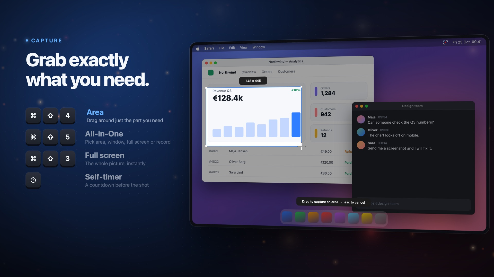
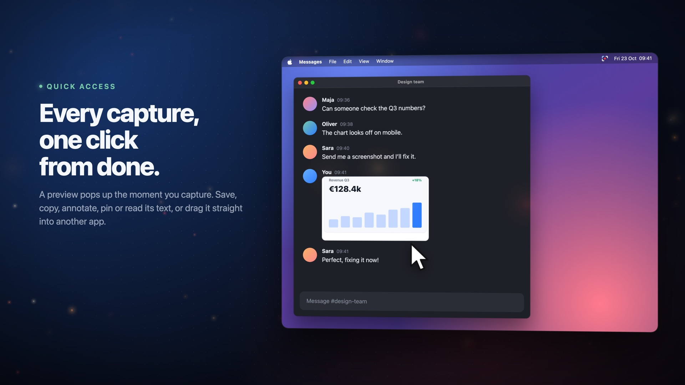
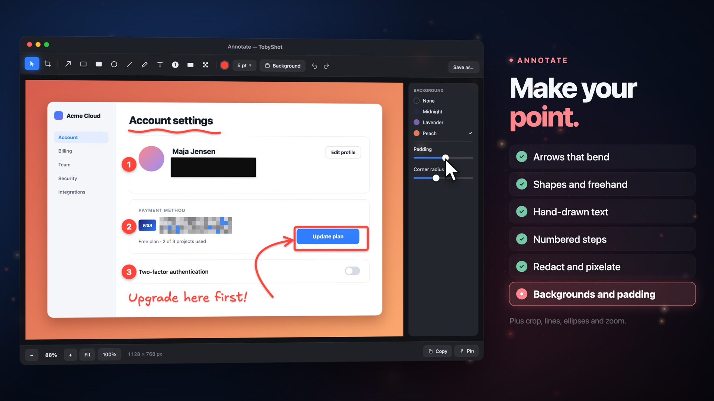
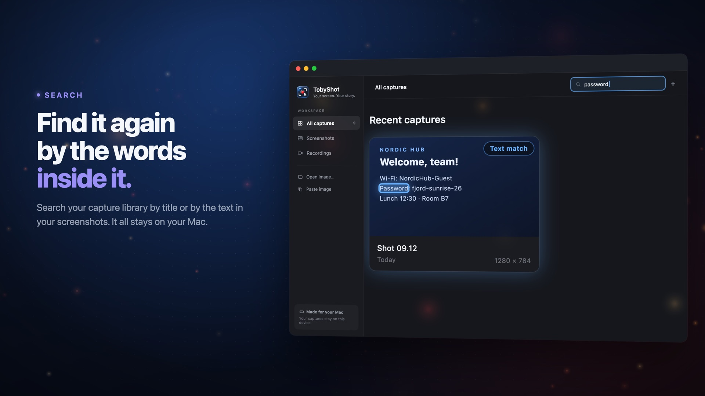
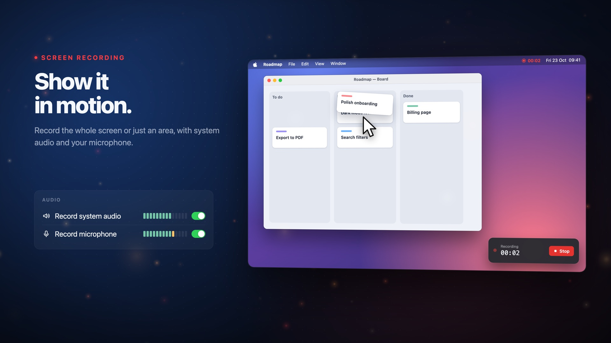
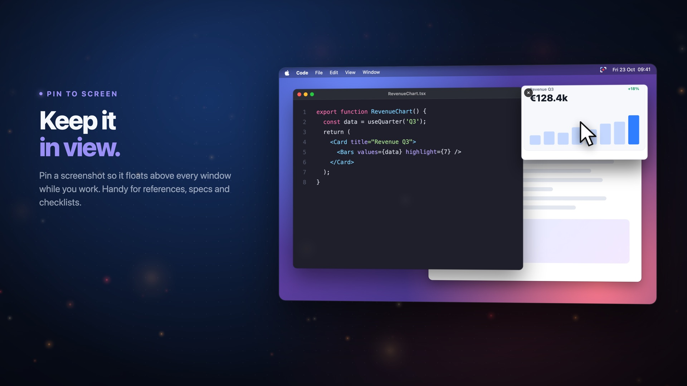
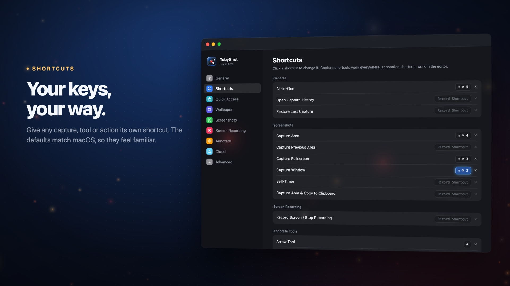
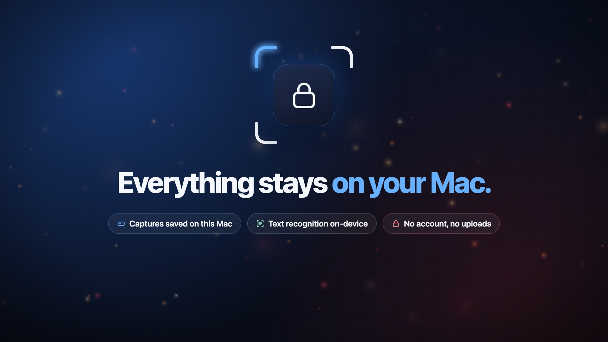

# TobyShot: free screenshot and screen recording app for macOS

TobyShot is a free macOS app for taking screenshots, recording your screen, annotating captures, and finding them again by the text inside them. It runs from the menu bar and keeps every capture on your Mac.

**[Download the latest release](https://github.com/TobiasRoland123/tobyshot/releases/latest)** · Requires macOS 15 or newer, on Apple silicon or Intel · [Installation steps](#install)

## Features

- **Capture:** grab an area across multiple monitors, a window, or the full screen with keyboard shortcuts, with an optional self-timer.
- **Quick Access:** a preview appears after every capture so you can save, copy, annotate, pin, or read its text. Recent captures stay stacked there, and you can drag any of them into another app.
- **Annotate:** add arrows that bend, shapes, freehand drawing, hand-drawn text, and numbered steps; redact or pixelate private details; crop; and add a background with padding. Paste screenshots into the annotation canvas with ⌘V, then move and resize them to make insets or side-by-side comparisons.
- **Record:** record your screen with optional system audio and microphone.
- **Search:** TobyShot recognizes the text in every screenshot on your Mac, so you can search your capture history by title or by the words inside a screenshot, and copy the text out.
- **Codex:** open the latest screenshot in Codex with a configurable global shortcut.
- **Customize:** change the shortcuts and choose where captures are saved.

<table>
  <tr>
    <td width="50%"><br><b>Capture</b> an area, a window or the full screen.</td>
    <td width="50%"><br><b>Quick Access</b> lets you drag a capture straight into another app.</td>
  </tr>
  <tr>
    <td width="50%"><br><b>Annotate</b> with arrows, steps, hand-drawn text and redaction.</td>
    <td width="50%"><br><b>Search</b> your captures by the words inside them.</td>
  </tr>
  <tr>
    <td width="50%"><br><b>Record</b> your screen with system audio and microphone.</td>
    <td width="50%"><br><b>Pin</b> a screenshot so it floats above your work.</td>
  </tr>
  <tr>
    <td width="50%"><br><b>Shortcuts</b> for every capture, tool and action.</td>
    <td width="50%"><br><b>Private:</b> captures and text recognition stay on your Mac.</td>
  </tr>
</table>

Exports go to `~/Documents/Captures` by default. If you used an earlier version that saved to `~/Pictures/TobyShot`, TobyShot keeps using that folder until you choose another one. Closing the library keeps TobyShot running in the menu bar.

To use Codex, assign **Open Latest Screenshot in Codex** under **Settings → Shortcuts → General**. It starts unassigned and can be changed or disabled there. The action opens the latest screenshot from history, skipping newer recordings, in a new Codex composer for you to add a prompt and send. You can also run it from TobyShot’s menu bar menu. This requires a Codex Desktop version that supports opening image files.

## Install

**We don't have a paid Apple Developer membership.** TobyShot is self-signed and isn't notarized by Apple, so macOS may block it on first launch. Follow the steps below if you trust this repository and your download hasn't been modified.

1. Download `TobyShot-<version>.dmg` from **Assets** on the [latest release](https://github.com/TobiasRoland123/tobyshot/releases/latest). You don't need the **Source code** downloads.
2. Open the DMG and drag **TobyShot.app** into **Applications**.
3. open **TobyShot** from **Applications**.
4. If macOS says the developer can't be verified or Apple can't check the app for malicious software, dismiss the warning. Go to **System Settings → Privacy & Security**, scroll to **Security**, and click **Open Anyway** for TobyShot.
5. Confirm **Open** and follow any macOS confirmation prompts. Future launches should open normally.

These steps follow [Apple's guidance](https://support.apple.com/en-us/102445). Keep Gatekeeper enabled. If the warning says the app is damaged, contains malware, or will damage your computer, stop and contact the developer.

### Finish setup

On first launch, TobyShot opens a short setup checklist. Its default shortcuts (⌘⇧3, ⌘⇧4, and ⌘⇧5) match the built-in macOS screenshot shortcuts, which take priority until you turn them off. Setup lists only the shortcuts that conflict, including customized ones, and checks again when you come back from System Settings.

1. Turn off the listed shortcuts in **System Settings → Keyboard → Keyboard Shortcuts → Screenshots**, or choose different TobyShot shortcuts.
2. Allow screen capture as described below.
3. Choose the folder where TobyShot saves your screenshots and recordings, or keep `~/Documents/Captures`. macOS may ask you to allow TobyShot to access your Documents folder.
4. Take a test screenshot, then click **Finish Setup**.

You can skip setup and reopen it later from **Settings → General → Setup**.

TobyShot also asks once whether to launch when you sign in to your Mac, during setup or after updating an existing installation. Choose **Enable launch at login** or **No thanks**; it’s optional. You can change your choice later in **Settings → General → Launch at login**, where TobyShot also shows if macOS approval is still needed.

### Allow screen capture

1. Click **Allow Access** in setup, or **Check access** or **Capture area** in TobyShot.
2. Enable **TobyShot** in **System Settings → Privacy & Security → Screen & System Audio Recording**, then quit and reopen the app.
3. Click **Capture area** and drag to select a region.

Microphone permission is only needed when you enable microphone audio for recordings.

If capture still fails, quit TobyShot, remove only its entry from **Screen & System Audio Recording**, add the current **Applications → TobyShot.app** with **+**, and reopen it.

### Updates

Choose **Check for Updates…** from the menu bar or **Settings → About → Updates**. Older versions without the updater can be replaced using the installation steps above. Your settings and capture history are kept.

## Development

Requires the Swift toolchain from Xcode or Command Line Tools. From the project directory:

```sh
bash scripts/run.sh
```

The first build creates a local signing certificate and stops until you trust it for code signing. Run this once, then rerun `scripts/run.sh`:

```sh
security add-trusted-cert -r trustRoot -p codeSign \
  -k "$PWD/.local-signing/tobyshot-signing.keychain-db" \
  "$PWD/.local-signing/certificate.pem"
```

Keep `.local-signing` across rebuilds so the app keeps its identity. Never commit its private keys or passwords.

```sh
bash scripts/test.sh          # Run tests
bash scripts/build.sh release # Build build/TobyShot.app
```
